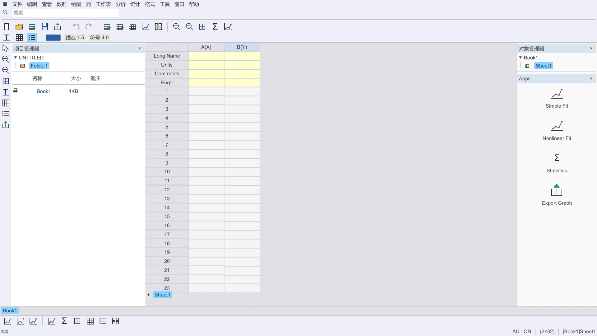

# PlotLab 0.3

纯 Rust 科学绘图与数据分析桌面原型，界面参照 Origin 的菜单、工具栏、项目管理器、工作表和图形窗口。

## 使用

直接打开 **PlotLab.exe**。计算、数据导入与图形导出均在程序内部完成。

- **数据 → 从文件导入**：CSV、TSV、TXT、DAT、XLSX。
- 单击列标题选择列；右击设置 X、Y 或 YErr。数据、名称、单位和备注均可编辑。
- **绘图**：折线、散点、点线；底部工具栏提供对应图标。
- **格式 → 绘图细节**：标题、坐标轴标题、颜色、线宽、符号、网格与图例。
- **分析 → 拟合**：线性、二次多项式、指数衰减、高斯单峰，支持 Y 标准差加权和 X 区间。
- **统计 → 描述统计**：样本量、均值、中位数、样本标准差、最小值和最大值。
- **文件**：保存 `.plab` 工程，导出 CSV、SVG、矢量 PDF 或 2160×1500 PNG。
- **帮助 → 示例项目**：校准曲线、指数衰减、单峰光谱。

图形与报告可通过项目管理器、底部窗口标签或“窗口”菜单切换；“窗口 → 平铺”同时显示数据、图形和报告。未保存内容每 15 秒及正常关闭时写入 `last-session.plab`，下次启动恢复。

## 当前范围

每个项目最多 16 个工作簿，每个工作簿一张工作表，最多 50,000 行、32 列。一个图形窗口、一个图层；F(x) 列计算、多图层、批量模板和 Origin 工程/插件兼容属于后续范围。

拟合排除空值、非有限数值和分析区间外的数据并报告数量；其他非数值文本提示行号。YErr 解释为观测标准差：加权拟合使用绝对标准差计算参数协方差，普通拟合根据残差估计协方差。95% CI 使用 Student t 近似。非线性拟合使用 Levenberg–Marquardt，正参数通过变换约束。

界面按事件重绘，标题变化时才更新窗口标题；绘图点按数据修订缓存；后台任务完成后通知界面。工作表使用可见行渲染，编辑撤销保留最多 20 个快照并限制内存。

## 开发与验证

```powershell
cargo run --release
cargo run --release -- --demo
cargo test --release
cargo run --release -- --smoke-test
```

使用 nalgebra / levenberg-marquardt / statrs 进行计算，calamine / csv 读取数据，Plotters / resvg / svg2pdf 生成图形。

`tests/fixtures/scipy-reference.json` 是预存的 SciPy 1.17.1 数值参考，覆盖四种模型及加权/普通拟合，供 Rust 测试核对参数、标准误和残差。运行和测试均使用 Rust。`verification` 为本地验收输出，自动恢复文件和运行数据由 Git 忽略。


